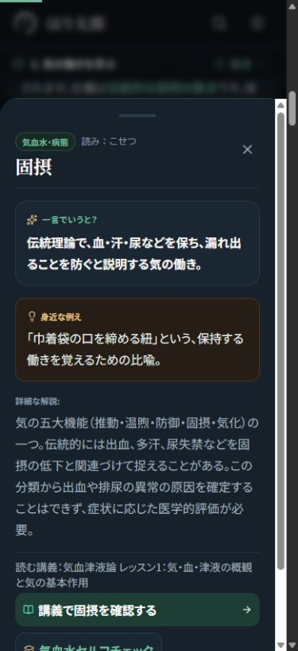

# はり太郎：未対応本文と学習導線の追加改善

2026年10月12日。先の共通UI改善に続き、公開教材の文章と学習導線を個別に確認した記録。

この文書は`7cd5812`で公開した追加改善の記録。さらに抽象的な表現と日本語を見直した最新結果は[natural-japanese-report.md](natural-japanese-report.md)を参照。

## 対応範囲

- 公開94講義の冒頭、学習目標、本文全文と、282問の設問・選択肢・解説を点検。明快な既存文は保持し、抽象的な説明と暗黙の復習先を具体化した。
- 追加改稿の実数は43講義、13問の解説、12記事、用語3項目。講義本文には必要な復習リンク31件を追加した。
- 公開12記事の本文全文、学習要約、関連記事の説明を点検・改稿。記事末の講義・クイズ・症例リンクは移動先の題名を通常の文で示し、行動を短いボタンにした。
- 用語32項目の定義・詳説・関連講義を点検。情志など必要な難語に短い説明を添えた。用語集とポップアップの本文を16px相当にし、長い講義名を省略せずボタンの外に表示した。
- トップ、使い方、臨床ツール案内、配穴演習、シミュレーターの導入文を具体化。利用者が何を選び、何を比較し、何を記録するかを示した。使い方ページの本文も16px相当で読む構成にした。
- 症例一覧は模擬症例を順に読み、候補と理由を考える案内へ変更。国試入口は、実際の問題・出典表示に合わせて「過去問演習」を「オリジナル演習」に統一した。
- 共通リーダー、出典ブロック、採点・記録・会員機能は、先の実装と既存の動作を維持した。

## 改稿例

| 変更前 | 変更後・補足 |
| --- | --- |
| 「次の講では、その知識が臨床のどの段階で使われるかを確認します。」 | 「次の『臨床の全体像』では、相談から情報収集、解釈、方針、再評価へ進む流れの中で、その知識をどこで使うか確認します。」実在する講義へ本文リンクを追加。 |
| 「基礎理論から臨床実践までを体系化する東洋医学ポータル。」 | 「講義で基礎を学び、クイズと症例演習で考え、ノートで振り返る東洋医学の学習サイトです。」 |
| 配穴を「再現性」や「最適化」で説明する案内 | 選んだ経穴と理由を保存し、前回と今回の候補・理由・経過を見比べる操作として説明。医学的な主治・配穴条件は維持。 |
| ポップアップ内の長い講義名を省略するボタン | 題名を通常の文章で表示し、「講義で○○を確認する」の短い行動リンクへ変更。 |

## 確認状態

[inventory.json](inventory.json)が最新の対象一覧。文章点検の完了と医学的監修の完了は別の状態として扱う。

- [lecture-editorial-audit.json](lecture-editorial-audit.json)：基礎以外81講・243問の個別状態と専門確認事項。
- [foundation-glossary-audit.json](foundation-glossary-audit.json)：基礎13講・39問・用語32項目の個別状態、具体的な変更前後。
- [article-editorial-audit.json](article-editorial-audit.json)：公開12記事の全文点検、引用・文献・見出しの比較結果。
- [entry-page-audit.json](entry-page-audit.json)：入口ページ42種類の文章・利用案内・既存導線の確認状態。
- [specialist-review.md](specialist-review.md)：専門的判断が必要な原文、掲載先、ソース行、確認事項の統合一覧。

「全文点検済み」は文章と学習導線の確認を示す。全医学的主張の正誤判定、古典原文の逐語照合、全参考文献の原著再確認を済ませたという意味ではない。361経穴の位置・適応、20症例の医療判断などの専門再審査は今回の文章校閲と区別している。

## 維持した内容

- 全94講のID、見出し文字と順序、古典引用のIDと順序、参考文献データ。
- 全282問のID、設問、選択肢、正答、本文への復習節。変更した解説も正答との対応を確認。
- 公開12記事の見出し順序、引用IDと順序、文献データ。既存URLを保持。
- QuestionEvidenceとその周辺の出典・改訂情報、次回復習、復習と類題、短い例。専用スタイルと折りたたみ処理は変更していない。
- 採点、進捗、旧回答履歴、保存、アカウント分離、会員制御。本文・解説が変わった問題は既存の改訂判定により再復習対象になるが、以前の回答履歴は保持される。

実際に本文・導線を改訂したページだけ、改訂日を10月12日へ更新した。記事の表示・構造化データ・サイトマップもページ別改訂日を使う。

## 検証

結合後のビルド・画面検証結果。

- `npm run build -- --webpack`：成功。型チェックと573ページの生成が完了。アプリのビルド設定は変更していない。
- `test:learning`、`test:reading`、`test:editorial`、`test:content`、`test:site`、`test:seo`、`test:medical-safety`、`test:sync`：成功。記事とサイトマップの改訂日検証は、変更ページを10月12日、未変更ページを既存日に保つ期待値へ更新した。
- 変更したTSX・日付設定のESLint：エラーなし。記事の既存`img`警告2件、症例一覧の既存未使用import警告3件は残る。
- 独立した差分レビューと不変条件の比較：全94講・282問・12記事の見出し、引用、参考文献、選択肢、正答、復習節を維持。本文内75講義リンクは実在。
- 幅320・375・390・430・1280pxで、変更した10種類の代表画面と用語ポップアップのdocument scrollWidth/clientWidthが一致。用語ポップアップ内も横はみ出しなし。本文16px・行間28px、学習リンクの高さ44px以上を実測。
- 用語索引の節への移動、ポップアップの開閉、記事から実在講義とその確認クイズへの移動をブラウザーで確認。記事末に実際の講義名と症例名が表示されることも確認。
- 使い方・用語集・用語ポップアップは、実際の描画済み部分と実CSSからスクリプトなしの検証HTMLを作り、根要素32px・本文32pxで5幅の横はみ出しなし。表示だけの検証で、静的HTMLで採点・保存を検証したとは扱わない。共通ナビは先行実装の検証範囲を維持。
- [followup-viewport-results.json](followup-viewport-results.json)に実測を保存。検証用公開ファイルと一時スクリプトは削除して本番へ含めない。

## 専門確認と確認外

治療効果の断定、妊娠中の経穴条件、古典の帰属、神経・経絡の同一性、薬剤減量などは推測で訂正せず、専門確認一覧に残した。独立した差分レビューでも、新たな医学的断定や正答との不整合は見つからなかった。

専門確認は145項目（講義41、記事18、用語6、ツール71、入口9）。完全に同一の原文・ファイルの重複は0件。動的クイズ24問、薬物9行、方剤9行は関連する論点内に列挙し、二重加算していない。公開ルート・閲覧条件と原文・行番号を最終ソースで確認した。

実ユーザーのログイン・課金・患者記録を使う保存、Search Consoleによる順位・クリック率の測定は実行していない。文字と導線の改善を、専門監修完了や検索順位向上として報告しない。
