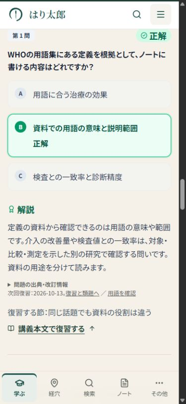
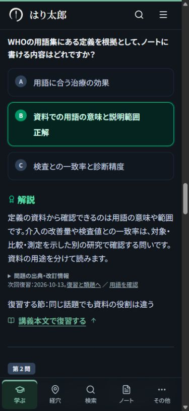
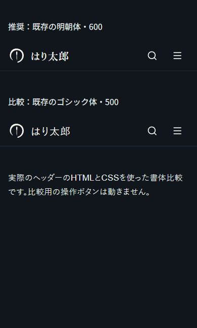
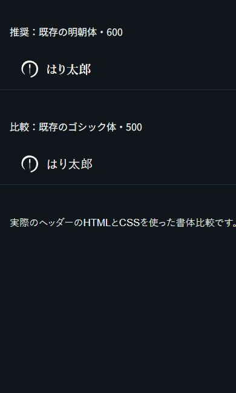

# はり太郎：読みやすさと学習導線の改善

2026年10月12日。添付指示書に基づく実装・検証記録。

この文書は先行する共通UI改善の記録。追加の本文校閲と最新の確認状態は[followup-report.md](followup-report.md)と[inventory.json](inventory.json)を参照。

## 実装した範囲

| 対象 | 対応 |
| --- | --- |
| 全94講義の共通リーダー | 冒頭に既存の要約を表示。「このページで分かること」に見出しを変更。スマホでは講義外枠の背景・枠線・水平余白を除去 |
| 全94講義・282問の共通クイズ | スマホの外枠・問題カード・解説の入れ子を解消。選択肢の境界を維持。問題間32px、選択肢間12px、解説まで24px。解説16px・行間1.75、正誤・解説見出し18px。選んだ誤答と正解を文字で識別 |
| キーボード操作 | PCの開始部分に数字キー案内を1回表示。選択肢数から案内を生成。1〜9/A〜Zを実データの表示順に対応。入力・変換・長押し・修飾キー・モーダルを抑制。フォーカス／ポインターで選んだ問題を現在の対象にする |
| 解説から本文へ | 「講義本文で復習する」に短縮。節名を外側に表示。既存の本文検索・スクロール・フォーカスを維持 |
| 章末演習99問 | スマホの外枠と内側余白を削減。正解・選んだ誤答・解説を識別。採点・記述ノート保存は維持 |
| 今日の復習・国試の講義問題・奇経クイズ | 解説を本文相当の大きさにし、未選択肢を極端に薄くしない。読む部分の囲みをスマホで除去 |
| トップ・使い方・ツール説明 | 学ぶ／確かめる／本文に戻る／記録する操作を具体的に説明。トップのdescriptionとOG説明を一致させる |
| 講義10件 | 概論3、陰陽2、生命機能1・12、五行3、診断2・8、治法2・4・5の本文・要約・学習内容の該当箇所を改訂 |
| 診断8の比較 | 既存用語集の定義から気虚・陽虚・血虚の2列比較表を追加。単一症状で確定しない架空例と復習リンクを添える。末尾への追加で既存見出しIDを維持 |
| 記事の学習案内 | 経絡記事の学習要約と舌診記事から次の記事へ進む理由を具体化 |
| ヘッダー | 既存Noto Serif JPの600をサイト名だけに再利用。本文・メニュー・ボタンはゴシックのまま。新しいフォントやロゴ素材は追加していない |

## 文章の変更例

- 変更前：「用語が国際的に整理されていることと、その用語で説明した治療が有効であることは、資料が答える問いとして分けて考えます。」
- 変更後：「言葉の意味が国際的に整理されていても、それだけで治療の効果が証明されたことにはなりません。」前の2文で用語集の用途と、ほかの治療などとの比較研究を説明。
- 変更前：「本治と標治の不毛な二項対立を解消し、患者のリアルな状況に応じた動的優先順位決定プロトコルを確立する。」
- 変更後：「本治は背景や持続要因、標治は現在の症状や支障に着目する方針です。」続けて緊急性、苦痛と生活機能、全身状態と負担、経過と評価を列挙。
- 変更前：「五行と病機への応用は後の章に位置づけます。」
- 変更後：「五行と病機への応用は後の章で扱います。」同じ段落で営衛・三焦・昇降出入がそれぞれ何に着目する説明かを具体化。

## 対象一覧と確認の限界

[inventory.json](inventory.json)に42種類のページ実装、94講義、12記事、32用語、本文データ源、追加の問題データ源を記録。共通UI対応と、本文の個別改訂は別の状態として記載した。

全94講義のタイトル・冒頭要約と指定の確認語を点検。用語集32項目の定義・要約を読み、明快な既存文は維持した。12記事はタイトル・学習要約・導線を点検。全本文の一文ずつの校閲、全問題の専門家による正答・誤答解説の再審査、全361経穴の医学的再照合は未完了。共通UI対応を「全文章の改稿完了」とは扱わない。

専門的確認を要する既存箇所：

1. `src/components/kikei/KikeiQuizSection.tsx`の問題生成内に「即効性を示します」「不可欠です」という効能・必要性の表現がある。対象、介入条件、比較研究の裏づけと、伝統的主治との区別が必要。今回は正答データや医学的な断定を推測で変更していない。
2. 診断2の到達目標の事故防止の保証に読める表現と、治法5の到達目標の処方・医療過誤回避の表現。Webで確認する学習目標と、指導下の臨床技能としての到達目標の区別を運営者・専門家が確認する必要がある。
3. 全94講義の238参考文献の表示・出典範囲は既存検証を維持。既存の14件の未照合文献、古典の逐語照合、専門家監修の未完了表示はそのまま。

Search Consoleの実データは使用していない。順位・クリック率の改善は測定していない。既存ページの改善を優先し、新規記事・URL統合は行っていない。方針確認には[Google Search Central](https://developers.google.com/search/docs/fundamentals/creating-helpful-content)を参照した。

## 画面と操作の検証

- 幅320・375・390・430・1280pxの代表講義で、文書のscrollWidthがclientWidthと一致。スマホの水平余白はページ側16pxだけになり、320pxでは本文273pxを確保（スクロールバー15pxの環境）。PCの講義カードと読み幅を維持。
- `viewport-results.json`に実測値を保存。解説16px、行間28px。キーボード案内は1024px未満で非表示。
- 出典の文言・リンク・順序・QuestionEvidence自体は変更していない。12pxの専用文字と開閉をブラウザーで確認。隣接する次回復習・復習と類題・短い例の表示も維持。
- 文字200%は実際に描画したDOMから作成した、スクリプトを除いた検証用HTMLで確認。根要素32px、解説32pxで上記5幅の横はみ出しなし。これは文字拡大時の表示検証であり、静的検証用HTMLでは回答操作を検証していない。`text-200-results.json`に実測値を保存。
- ブラウザーで正解・不正解・合格・誤答だけの再挑戦を確認。誤答だけの再挑戦では正解済みの2問を維持し、誤答の1問だけ回答可能になった。本文への復習は既存の実見出し検索とフォーカス移動をハンドラー検証。
- 下部ナビ・ヘッダーの高さとsafe-areaを扱う既存CSSとResizeObserverを維持。新しい固定ナビを追加していない。
- ライト・ダークの代表画面と実際のヘッダーHTML/CSSによる2書体比較を保存。明朝体は専門学習サイトの見出し書体と統一でき、既存の文字・鍼マーク・検索・メニューが収まるため採用。
- 会員制御と保存同期は既存回帰検証で確認。実会員としてのログイン、課金、ユーザーデータを使う保存は今回実行していない。

代表画像：

## 実行したチェック

- `npm run build -- --webpack`：成功。型チェック、573ページ生成。通常のTurbopackではこの環境のGoogle Fonts通信と子プロセス起動で失敗したため、公式のWebpackオプションで検証。アプリのビルド設定は変更していない。
- `npm run test:learning`：成功。17種類の実クイズハンドラーフロー、94講義／564回の選択肢採点、11コース経路、復習・ノート・同期・進捗・出典の既存チェック。
- `npm run test:editorial`、`test:reading`、`test:site`、`test:seo`、`test:medical-safety`、`test:content`、`test:sync`：成功。
- 比較表追加後に章末問題と情報整合性の既存チェックを再実行：成功。
- 変更したTSXと検証スクリプトのESLint：エラーなし。奇経クイズに既存の`quizSeed`依存の警告1件（再シャッフル動作を維持）。
- `git diff --check`：成功。sources/と同期参照資料は変更していない。

## 残課題

全ページの本文の個別校閲と医学的審査、全ルートでの文字200%・全操作の実機確認は未完了。代表画面の検証を全ページの実機確認と同一視しない。既存の専門的確認箇所は上記参照。実ユーザーでの会員・課金操作とSearch Console分析は今回の確認外。

公開状況はチャットの最終報告に記録する。
