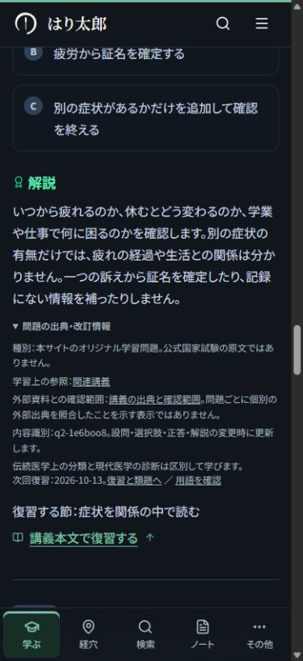

# 抽象的な表現と不自然な日本語の改善

2026年10月12日。`7cd5812`で公開した教材を再読し、用語の意味、比較する対象、読み取る情報、次の操作が一読して分かるように改稿した。

## 改稿の方針

「理解する」「整理する」という語を機械的に置換せず、その前後で何をするかが分かるか確認した。名詞の連結を短い文に戻し、何と何を比べるか、誰が何を記録するか、どの条件で説明が変わるかを示した。既存の例を使い、すべての段落に例や要約を足すことは避けた。

医学的な意味・条件・根拠の強さ、古典引用と文献、設問・選択肢・正答、見出し・URL・保存機能を維持した。専門確認一覧の原文は推測で変更していない。

## 具体例

| 変更前 | 変更後 |
| --- | --- |
| 資料の役割と根拠の範囲、現代医療との関係を整理する。 | 古典・用語集・臨床研究が、それぞれ何を確かめるための資料かを確認する。 |
| 原因、過程、現れ、状態の整理を分ける。 | 原因を表す病因、変化の過程を表す病機、現れた症状、所見から考える証を区別する。 |
| 正常な働きの用語を知り、臓腑の基礎へ進む土台を作ります。 | 病態の各論へ進む前に、正常な働きを表す用語を確かめ、続く臓腑の講義に進みます。 |
| 個人運営の学習・臨床支援ポータルです。 | 一人で資料の調査、記事の執筆、サイトの開発を行っています。運営者本人が掲載内容と出典を確認していることも明記。 |
| この最小構成に最適化する（余剰穴を一括剪定） | 上の構成に変更する（候補から外れた経穴を削除） |
| 気血水：『変更前』➔『変更後』へ変更。生体物質の動態推論が更新されました。 | 気血水の条件を「変更前」から「変更後」に変更しました。候補と説明が更新されます。 |

ツールの案内は実際のハンドラを読み、何が変わるかを説明した。配穴の変更ボタンは選択経穴を提案された一覧へ置き換える既存操作で、集計・推論・医学データは変更していない。通知文の「変更前」「変更後」は実際に選んだ条件名が入る。

## 個別記録

- [natural-japanese-lecture-audit.json](natural-japanese-lecture-audit.json)：基礎以外81講・243問。各IDの確認状態、変更欄、要約・目標・本文・解説の具体例。
- [natural-japanese-foundation-audit.json](natural-japanese-foundation-audit.json)：基礎13講・39問・用語32項目。全変更前後、本文量の比較と不変条件。
- [natural-japanese-article-audit.json](natural-japanese-article-audit.json)：公開12記事。本文73段落、学習案内21欄、図説明5件、関連記事の理由10件の改稿。
- [natural-japanese-figure-audit.json](natural-japanese-figure-audit.json)：実公開59学習図。32図の51説明を改稿し、27図は明快なため保持。
- [natural-japanese-interactive-audit.json](natural-japanese-interactive-audit.json)：残り13図の表示文・操作案内。9図の27表示文を改善し、明快な4図は保持。
- [natural-japanese-entry-audit.json](natural-japanese-entry-audit.json)：使い方、学習案内、コース一覧、臨床案内、文献一覧、ツール、6コース、フッターの43箇所。

対象一覧と最新の状態は[inventory.json](inventory.json)に集約している。文章の点検と医学的な監修は別の状態として記録する。

講義のデータを改稿したのは92講。図の表示文だけを改善した陰陽7も含めると、変更がある講義ページは93件。陰陽4は既存文が明快なため保持した。確認問題は52解説、用語は13項目、記事は12件、コースは6件の該当欄を改稿した。

## 意味と操作の確認

- 全94講のID、本文見出しと順序、引用ID、図ID、内部URL、参考文献を変更前と比較。
- 282問の設問・選択肢・正答・復習先を維持。変更は52問の解説のみで、既存の定義や例に沿って正答と誤答の違いを説明。
- 12記事の文献、引用IDと順序、数値、医学的条件、記事・図の配置、既存の講義・症例・関連記事IDを維持。
- 学習順との独立レビューで、生命機能論の案内に未習の五行を加えた箇所を修正。陰陽・気血津液・臓腑の既習内容だけを挙げる案内へ戻した。
- 治法6の要約「津液を潤す滋陰・生津」は、同じ本文にある「潤いの不足を扱う滋陰・生津」へ修正。新しい定義を加えず、既存の本文に合わせた。
- 別担当のレビューで、上記2点の修正後に、意味・条件・正答や操作案内の変更が必要な問題は見つからなかった。

## 検証結果

- `npm run build -- --webpack`：最終版で成功。型チェックと573ページの生成が完了。
- `test:learning`、`test:reading`、`test:editorial`、`test:content`、`test:site`、`test:seo`、`test:medical-safety`、`test:sync`：成功。93講義ページ・6コースの改訂日と、未変更ページの既存改訂日も確認。
- 別担当による意味・日本語・学習順・操作案内の差分レビューを実施。実表示13図は、変更前のTSXに27件の表示文置換だけを適用した内容と最終ファイルが一致することも確認。
- 代表14ページを320・375・390・430・1280pxで表示し、70ケースでdocument scrollWidthとclientWidthが一致。[natural-japanese-viewport-results.json](natural-japanese-viewport-results.json)に実測を保存。
- ブラウザーで改稿した正解理由を表示し、専用の「問題の出典・改訂情報」の開閉と、隣接する次回復習・復習先リンクを確認。専用の文言・リンク・スタイル・処理は変更していない。
- 画面に出ていた箇条書きの余分な「： -」を、陰陽3の2箇所で除去。説明文・医学的条件・引用は維持し、実際のMarkdown解析によるブロック数と見出しの添字が変わらないことを確認。修正後に読書・編集・出典チェックと本番ビルドを再実行。
- 最終ビルドをブラウザーで再読み込みし、2箇所の記号がなくなった表示と、陰陽の図で「陰陽可分」を選んだ際の説明の切り替えを確認。
- 専門確認146項目の原文・ソース位置を保持。最終19ファイルのSHA256が専門一覧の確認値と一致。

ESLintでは、配穴ツールの既存`react-hooks/set-state-in-effect`エラー1件と未使用import警告7件を確認した。変更前の`HEAD`を別ファイルで同じ設定にかけても、同じ行・規則・件数になった。今回変更したのは表示文だけで、この初期化処理は維持した。他の入口・コースの変更ファイルにESLintエラーはない。

## 専門確認

[specialist-review.md](specialist-review.md)の原文と掲載先を保持し、行番号とソースの確認値を今回の最終ファイルに合わせて更新した。配穴ツールの「黄金比（2〜4穴）」も、教材内の集計名なのか臨床的な優位性を示すのか確認が必要なため一覧に追加した。効果や施術条件を推測で変更していない。

原典の全照合、全361経穴と20症例の医学的再審査、実患者記録や課金を使う操作、検索順位の測定は、この日本語校閲の確認範囲に含めていない。
